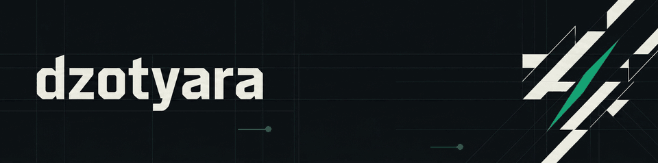

# dzotyara

Building AI agents, automation tools, and local LLM workflows — focused on making AI tooling practical and autonomous.

---

### Selected Projects

<table>
  <tr>
    <td width="50%" valign="top">
      
       <b><a href="https://github.com/dzotyara/ai-forge">AI Forge</a></b> — approve and answer Claude Code and Codex from Discord and Telegram.
    </td>
    <td width="50%" valign="top">
      
       <b><a href="https://github.com/dzotyara/Text2Craft">Text2Craft</a></b> — generate and place Minecraft structures from prompts with local Ollama models.
    </td>
  </tr>
  <tr>
    <td width="50%" valign="top">
      
       <b><a href="https://github.com/dzotyara/botyara">Botyara</a></b> — a context-aware group chat bot for Telegram and Discord.
    </td>
    <td width="50%" valign="top">
      
       <b><a href="https://github.com/dzotyara/HomeLLM">HomeLLM</a></b> — an offline desktop AI assistant for local models.
    </td>
  </tr>
</table>

---

### Links

* **Telegram:** [t.me/dzotyara](https://t.me/dzotyara) — fastest way to reach me
* **GitLab:** [gitlab.com/JustDzot](https://gitlab.com/JustDzot)
* **Boosty:** [boosty.to/dzotyara](https://boosty.to/dzotyara) — support open-source work
* **Discord:** `dzotyara`

 

