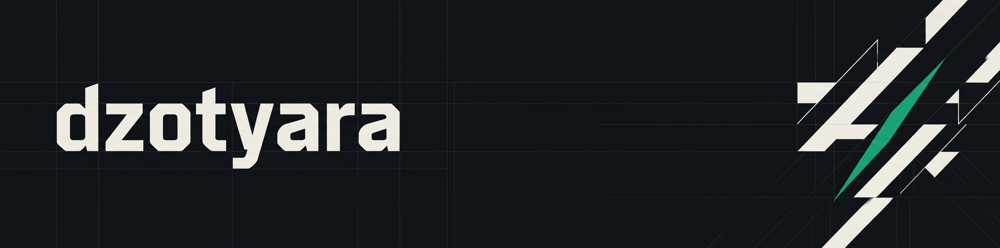

# dzotyara

Building AI agents, automation tools, and local LLM workflows — focused on making AI tooling practical and autonomous.

**Currently building:** [**AI Forge**](https://github.com/dzotyara/ai-forge) & [**Text2Craft**](https://github.com/dzotyara/llmcraft)

---

### Selected Projects

| Project | Description |
| :--- | :--- |
| [**AI Forge**](https://github.com/dzotyara/ai-forge) | Manage Claude Code sessions from Telegram and Discord, and approve Codex requests from Discord. |
| [**Text2Craft**](https://github.com/dzotyara/llmcraft) | Generate, preview, and place Minecraft structures from prompts using local Ollama models. |
| [**Botyara**](https://github.com/dzotyara/botyara) | Context-aware group chat bot for Telegram and Discord with a web panel and OpenRouter integration. |
| [**HomeLLM**](https://github.com/dzotyara/HomeLLM) | Offline desktop AI assistant for running local models on your PC. |

---

### Links

* **Telegram:** [t.me/dzotyara](https://t.me/dzotyara) — fastest way to reach me
* **GitLab:** [gitlab.com/JustDzot](https://gitlab.com/JustDzot)
* **Boosty:** [boosty.to/dzotyara](https://boosty.to/dzotyara) — support open-source work
* **Discord:** `dzotyara`

 

